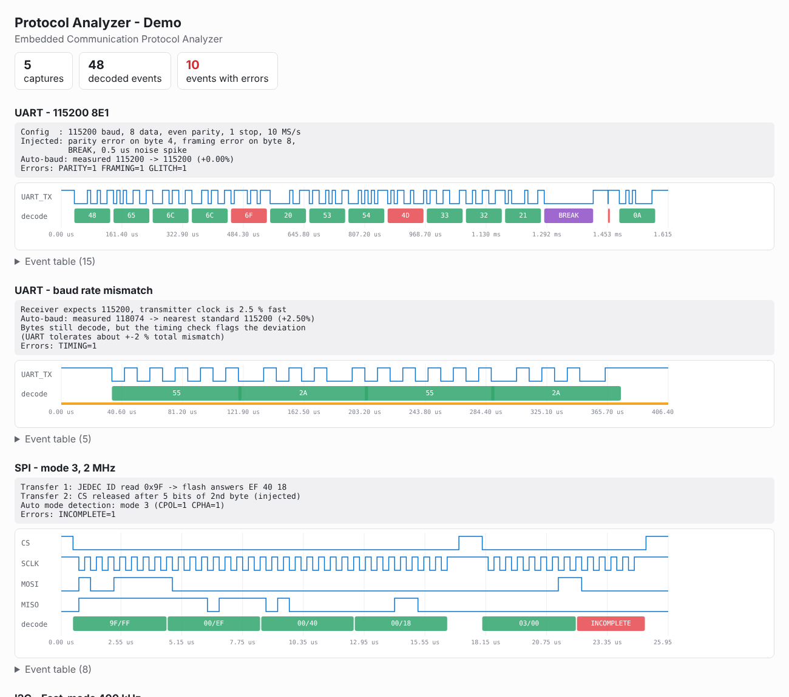

# Embedded Communication Protocol Analyzer

A software logic analyzer in **C99**: generates simulated waveforms, decodes
**UART, SPI, I2C and CAN**, detects protocol and timing errors, and produces an
HTML report with the waveforms drawn as SVG.

It also reads **CSV captures exported by PulseView / Saleae Logic**, so traces from
a cheap USB logic analyzer connected to a real board can be analyzed with the same decoders.



## Features

| Protocol | Decoding | Error / timing detection |
|----------|----------|--------------------------|
| **UART** | 5-9 data bits, none/even/odd parity, 1-2 stop bits, 3-sample majority vote | parity, framing, BREAK, glitch (false start bit), incomplete frame, **auto baud detection**, baud mismatch > 2 % |
| **SPI**  | all 4 modes (CPOL/CPHA), MSB/LSB first, any word size, MOSI + MISO | CS released mid-word, data changing on the sampling edge (wrong mode), CPOL mismatch, CS->SCLK setup, **auto mode detection** |
| **I2C**  | START, repeated START, STOP, 7-bit address + R/W, ACK/NACK | address NACK, write NACK (read-end NACK correctly treated as normal), interrupted byte, **7 timing parameters checked against UM10204** (Standard / Fast mode) |
| **CAN**  | classical 11-bit frames, data + remote frames, bit destuffing, hard synchronisation | **CRC-15**, stuff error, form error (delimiters/EOF), missing ACK, extended-ID detection |

Other:
- **Fault injection** in every generator (wrong parity, missing stop bit, cut transfers, NACK, CRC/stuff errors, bad timing)
- **Fuzz testing** with a reproducible seed, run under AddressSanitizer + UBSan
- **Export**: VCD (GTKWave), CSV, HTML report; colour-coded decode row with hover details
- No dependencies beyond the C standard library

## Build and run

```bash
make            # build/pa
make test       # 117 unit tests (with AddressSanitizer + UBSan)
make demo       # simulate all protocols -> out/report.html, out/*.vcd, out/*.csv
make fuzz       # 2000 iterations x 4 protocols under sanitizers
```

Analyze a capture:
```bash
./build/pa analyze capture.csv uart --baud auto --parity even --report r.html
./build/pa analyze capture.csv spi  --mode auto
./build/pa analyze capture.csv i2c  --speed fast
./build/pa analyze capture.csv can  --bitrate 500000 --vcd can.vcd
```
Exit code is `2` when errors are found, so it can be used in scripts / CI.

## Architecture

```
            generators (uart/spi/i2c/can_gen_*)      CSV file (real capture)
                         \                          /
                          v                        v
                       waveform_t   data[ch][i] = 0/1, sample_rate
                                   |
                     decoders (uart/spi/i2c/can_decode)
                                   |
                       event_list_t  {type, start, end, value, errors, note}
                       /           |             \
              terminal table   HTML + SVG report   fuzz checks
```

All decoders share one data model: a waveform in, a list of events out. Each
event records its sample range and a bit mask of `ERR_*` flags, so the
report, the tests and the fuzzer work the same way for every protocol.

```
include/  src/
  waveform   sample storage, edge search, fault injection helpers
  events     event list, error names, labels, sorting
  uart spi i2c can   generator + decoder per protocol
  wave_io    CSV import/export, VCD export
  report     terminal table, HTML/SVG report
  fuzz       random round-trip + fault injection testing
  main       command line interface
tests/       unit tests
```

## How the decoders work (short)

- **UART**: wait for a falling edge, check the start bit is still low at its centre
  (otherwise a glitch), then sample each bit at `start + (k + 1.5) x bit_time`.
  Auto-baud: collect all pulse widths, take the shortest width that occurs repeatedly
  (a lone glitch is ignored), then refine as `total width / total bits`.
- **SPI**: inside each CS-low window, sample MOSI/MISO on the rising edge for modes 0/3
  and the falling edge for modes 1/2. Mode detection: CPOL = clock level when CS falls,
  CPHA = which clock edge the data changes on (data changes on the non-sampling edge).
- **I2C**: START/STOP = SDA change while SCL is high; bits sampled on SCL rising.
  The SCL rise just before a STOP/Sr is treated as tentative and discarded.
  Worst value of each timing parameter is reported once with the number of violations.
- **CAN**: SOF edge, then one sample per bit with hard synchronisation on edges near
  the bit boundary (decodes a transmitter 1 % off). Destuffing, DLC-driven frame length,
  CRC-15 (verified against the catalogue check value `0x059E` for "123456789").

## Fuzz results (`make fuzz`, seed 1)

| Protocol | Round trip ok / fail | Faulty: detected | silent | harmless | Invariant fail |
|----------|---------------------:|---------:|-------:|---------:|------:|
| UART | 2000 / 0 | 80.0 % | 9.0 % | 11.1 % | 0 |
| SPI  | 2000 / 0 | 83.2 % | 9.4 % | 7.5 %  | 0 |
| I2C  | 2000 / 0 | 87.8 % | 8.2 % | 4.0 %  | 0 |
| CAN  | 2000 / 0 | 85.3 % | 3.0 % | 11.7 % | 0 |

*silent* = decoded payload changed but no error was reported. This is a property of
the protocols, not a decoder bug: SPI and I2C have no checksum, and UART without parity
cannot detect a flipped data bit. With truncation faults disabled, CAN's silent rate is
**0 %** (CRC catches every corruption); its remaining silent cases are captures cut
before a frame starts, which no decoder can know about.

## Real capture: two-node CAN bus

Captured with a USB logic analyzer (8 MHz) on the RX line of an STM32 node in
[can-gesture-network](https://github.com/imtuaz/can-gesture-network) (ESP32 + STM32, 500 kbit/s).
The PulseView `.sr` files were converted with that repo's `tools/sr2csv.py`.

```bash
./build/pa analyze examples/can_tilt_0x110_0x200.csv can --bitrate 500000 --report r.html
```
```
  48.969 ms    CAN   FRAME   ID 110   -   ID 0x110 DLC 4 | data 55 01 9E FF
  ...
  2.0490 s     CAN   FRAME   ID 110   -   ID 0x110 DLC 4 | data BC F9 AB F9
  2.0492 s     CAN   FRAME   ID 200   -   ID 0x200 DLC 1 | data 00
  29 events, 0 with errors
```
2.5 s of traffic: 25 periodic tilt frames (0x110, every 100 ms) and 4 replies from the STM32 (0x200),
all with a valid CRC-15. The IDs, data and CRC match PulseView's own CAN decoder on the same capture.

`examples/can_0x123_esp32.csv` is a single frame (0x123, data AB B5). The capture was triggered on the
SOF edge, so the first sample is already dominant; 30 µs of idle bus was prepended during conversion
so the decoder can see the SOF edge.

## Limitations

- CAN FD and 29-bit extended IDs are detected but not decoded
- I2C 10-bit addressing and clock stretching analysis are not implemented
- UART auto-baud needs some single-bit pulses (a stream of only `0x00` fails)
- Captures are held fully in memory (1 byte per sample per channel)

## Possible next steps

- Add the real CAN captures in `examples/` as regression tests
- 1-Wire / LIN decoders, CAN FD
- Streaming decoding for very long captures
